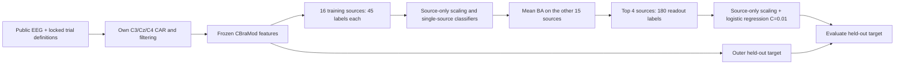

# EEG Transferability-Aware Source Selection

Can a source subject's ability to classify other people predict which EEG data are useful for an unseen person? This research repository studies that question with **frozen CBraMod features, controlled source selection, and explicit annotation accounting** on PhysioNet EEGMMIDB and Cho2017.

The contribution is an auditable empirical study, including unsuccessful hypotheses. It does not establish a new foundation model, a causal physiological mechanism, or state-of-the-art performance.

## Method



No target data enter ranking, standardization or fitting. Each target is evaluated across three fixed source pools; random selection uses three fixed seeds. BA is the mean of class recalls, aggregated equally across targets.

## Results and their conditions

Archived results, BA in percent; differences are percentage points (pp). These are **historical measurements**, not outputs of the synthetic example.

| Readout | PhysioNet (24 targets) | Cho2017 (52 targets) | Ranking labels | Readout labels | Unique source labels |
|---|---:|---:|---:|---:|---:|
| Random 4 sources (A) | 59.00 | 58.20 | 0 | 180 | 180 |
| Transfer-ranked 4 sources (B) | 63.35 | 60.49 | 720 | 180 | **720** |
| All 16, matched readout (C) | 59.09 | 59.12 | 0 | 180 | 180 |
| All 16, full bank (C720) | **64.91** | **61.74** | 0 | 720 | 720 |

B−A: **+4.34 pp** (descriptive paired target-bootstrap 95% interval [2.03, 6.68]) and **+2.29 pp** ([1.30, 3.38]). B−C: +4.26 / +1.37 pp. This supports selection under a fixed **final readout** budget; it does **not** establish lower total annotation cost. The 180 fitting labels are a subset of the 720 ranking labels, not an additional cost. Target evaluation labels are separate.

The source pools overlap; intervals condition on these populations and trial banks, and are not evidence from independent pool replications. Both datasets now have development history. The separate PhysioNet test partition remains sealed.

| Negative control / follow-up | PhysioNet | Cho2017 | Decision |
|---|---:|---:|---|
| Two-stage selection vs all-source, 324 total labels | −1.86 pp | −0.84 pp | No-Go |
| Complementarity predictor MAE reduction | −0.0025 pp | −0.0074 pp | No-Go |
| Full-source transfer weighting vs uniform, 720 labels | +0.46 pp | +0.10 pp | No-Go: insufficient consistent advantage over controls |
| Subject-center distillation | Failed new-development replication | Not tested | No-Go |

See [all results](docs/RESULTS.md), [locked protocol](docs/PROTOCOL.md), and [limitations](docs/LIMITATIONS.md). Negative results and original scripts are preserved.

## Run in minutes: synthetic CPU example

Python 3.11 recommended. No EEG downloads, model weights, GPU or account are needed:

```bash
python -m venv .venv
# Linux/macOS: source .venv/bin/activate
# Windows PowerShell: .venv/Scripts/Activate.ps1
python -m pip install -r requirements-dev.txt
python -m pytest -q
python scripts/verify_results.py
python scripts/make_demo.py --output outputs/synthetic.npz
python scripts/reproduce.py --features outputs/synthetic.npz --output outputs/demo
```

The example validates computation only; its scores are **not EEG evidence**. Outputs include the transfer matrix, per-target/per-pool scores, annotation budgets, fit-index manifests, and package/input provenance. Output directories must be new.

## Public EEG to evaluation

1. Obtain public EEG and the upstream CBraMod checkpoint separately.
2. Follow [the complete preparation and execution commands](docs/REPRODUCIBILITY.md). The new `prepare_features.py` implements recovered historical preprocessing and inference; the locked PhysioNet development window manifest is included.
3. Run `reproduce.py` on the generated NPZ and compare against the result index.

**Validation boundary:** real-data spot checks reproduced preprocessing and the first 32 frozen features in each dataset exactly, and selected/full-source BA in one target/pool per dataset to floating-point precision. The complete newly assembled extraction CLI and every historical fold have not been rerun. CPU FP32 inference is a supported reference mode, not asserted identical to historical CUDA BF16. See [numerical validation](docs/NUMERICAL_VALIDATION.json) and [code review](docs/CODE_REVIEW.md).

## Repository map

- `scripts/prepare_features.py`, `download_physionet.py`: raw-data preparation and frozen inference.
- `scripts/reproduce.py`, `make_demo.py`: portable CPU experiment and synthetic fixture.
- `scripts/verify_results.py`: independently recompute 42 archived CSV/JSON numeric checks.
- `scripts/b_*.py`: preserved historical implementations; [dependencies and execution order](docs/REPRODUCIBILITY.md#historical-scripts).
- `configs/`: public development windows and EDF hashes; no test partition, private trial IDs or EEG signals.
- `results/`: unmodified aggregate and subject-level evidence, including No-Go experiments.
- `tests/`, `.github/workflows/`: lightweight validation and CI.

## Data, models and licensing

[PhysioNet EEGMMIDB](https://physionet.org/content/eegmmidb/1.0.0/), [Cho2017](https://gigadb.org/dataset/100295), [CBraMod](https://github.com/wjq-learning/CBraMod), and the [MOABB Cho loader](https://github.com/NeuroTechX/moabb/blob/develop/moabb/datasets/gigadb.py) are external resources. No EEG signals, weights or upstream model code are bundled. The reported pretraining corpus is TUEG; record-level overlap has not been independently excluded.

This repository currently has **no assigned open-source license**. Public visibility alone does not grant reuse rights. Upstream resources retain their own terms; see [third-party notes](docs/THIRD_PARTY.md). An owner-approved license is needed before advertising this as an open-source package.
